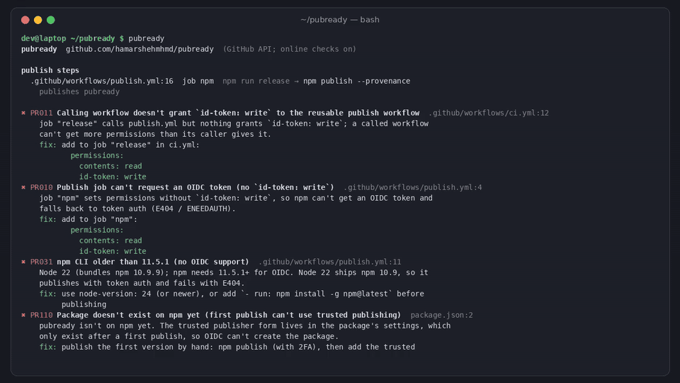

# pubready

[](https://github.com/hamarshehmhmd/pubready/actions/workflows/ci.yml)
[](LICENSE)
[](package.json)
[-lightgrey.svg)](package.json)

**Your `npm publish` from GitHub Actions failed with `404 Not Found - PUT`. The package exists. You have access. pubready tells you why, before you burn another version.**

It's a preflight for [npm trusted publishing](https://docs.npmjs.com/trusted-publishers/) (OIDC). It reads your workflows and `package.json` files, finds the things that make the publish fail (Node 22's npm 10, missing `id-token: write`, a `repository.url` with the wrong letter case, a reusable workflow, a package that doesn't exist yet, a leftover token), and prints the exact values to type into the npmjs.com trusted-publisher form. Got a red run already? `pubready explain <run URL>` reads the log and tells you which of those it was.



> Narrated 2-minute demo video: see the [v0.1.0 release](https://github.com/hamarshehmhmd/pubready/releases/tag/v0.1.0) (`demo.mp4`).

```sh
npx github:hamarshehmhmd/pubready
```

## Why

npm revoked classic tokens in Dec 2025 and pushes everyone to trusted publishing. The setup has half a dozen exact-match requirements, npm doesn't validate the form when you save it, and almost every mistake comes back as the same useless `E404 Not Found` (or `ENEEDAUTH`), after the tag is pushed.

- [npm/cli#8730](https://github.com/npm/cli/issues/8730) "OIDC publish failing from GitHub actions": 30 comments of people finding a different cause each: Node 20/22 ships npm 10 (needs 11.5.1+), owner name is case-sensitive, reusable workflows need the *caller's* filename, `.npmrc` tokens, `yml` vs `yaml`. "*In no shape or form should this scenario result in 404 Not Found.*"
- [npm/cli#8036](https://github.com/npm/cli/issues/8036): E422 because `repository.url` said `frontenddev-org`, GitHub says `FrontEndDev-org`.
- [jupyter-book/mystmd#2662](https://github.com/jupyter-book/mystmd/issues/2662), [lambdasistemi/cardano-swiss-knife#138](https://github.com/lambdasistemi/cardano-swiss-knife/issues/138), [SHUKE-LABS/baton#398](https://github.com/SHUKE-LABS/baton/issues/398): E422, `"repository.url" is ""`. Three tags, three failed releases.
- [npm/documentation#1926](https://github.com/npm/documentation/issues/1926), [Cratis/Scene#306](https://github.com/Cratis/Scene/issues/306): a *new* package can't use trusted publishing; the first publish has to be manual.
- This month alone: [meilisearch/strapi-plugin-meilisearch#1158](https://github.com/meilisearch/strapi-plugin-meilisearch/issues/1158), [MemMachine/MemMachine#1949](https://github.com/MemMachine/MemMachine/issues/1949), [Rahularya01/pi-antigravity#135](https://github.com/Rahularya01/pi-antigravity/issues/135): releases tagged, never reached npm.

And since 3 Sep 2026, new trusted publishers only allow `npm stage publish` unless you tick "Allow npm publish". One more silent switch.

## Install

Nothing to install, run it in your repo (needs Node 18.18+ and git):

```sh
npx github:hamarshehmhmd/pubready
```

Or keep it around:

```sh
npm install -g github:hamarshehmhmd/pubready
pubready --help
```

## Usage

### `pubready` / `pubready check [dir]`

This is a broken release setup for publishing pubready itself (`demo/make-demo-repo.sh` builds it): CI calls a reusable `publish.yml` on Node 22 with an old `NODE_AUTH_TOKEN`:

```console
$ npx github:hamarshehmhmd/pubready
pubready  github.com/hamarshehmhmd/pubready  (GitHub API; online checks on)

publish steps
  .github/workflows/publish.yml:16  job npm  npm run release → npm publish --provenance
    publishes pubready

✖ PR011 Calling workflow doesn't grant `id-token: write` to the reusable publish workflow  .github/workflows/ci.yml:12
    job "release" calls publish.yml but nothing grants `id-token: write`; a called workflow
    can't get more permissions than its caller gives it.
    fix: add to job "release" in ci.yml:
           permissions:
             contents: read
             id-token: write
✖ PR010 Publish job can't request an OIDC token (no `id-token: write`)  .github/workflows/publish.yml:4
    job "npm" sets permissions without `id-token: write`, so npm can't get an OIDC token and
    falls back to token auth (E404 / ENEEDAUTH).
    fix: add to job "npm":
           permissions:
             contents: read
             id-token: write
✖ PR031 npm CLI older than 11.5.1 (no OIDC support)  .github/workflows/publish.yml:11
    Node 22 (bundles npm 10.9.9); npm needs 11.5.1+ for OIDC. Node 22 ships npm 10.9, so it
    publishes with token auth and fails with E404.
    fix: use node-version: 24 (or newer), or add `- run: npm install -g npm@latest` before
         publishing
✖ PR110 Package doesn't exist on npm yet (first publish can't use trusted publishing)  package.json:2
    pubready isn't on npm yet. The trusted publisher form lives in the package's settings, which
    only exist after a first publish, so OIDC can't create the package.
    fix: publish the first version by hand: npm publish (with 2FA), then add the trusted
         publisher and finish a CI publish within 2 days
✖ PR104 repository.url casing differs from GitHub's canonical name  package.json:4
    pubready: repository.url says HamarshehMhmd/pubready, GitHub's canonical name is
    hamarshehmhmd/pubready. npm compares them case-sensitively and fails with E422 "expected to
    match https://github.com/hamarshehmhmd/pubready from provenance".
    fix: "repository": {
           "type": "git",
           "url": "git+https://github.com/hamarshehmhmd/pubready.git"
         }
▲ PR040 Long-lived npm token still wired into the publish job  .github/workflows/publish.yml:18
    NODE_AUTH_TOKEN: ${{ secrets.NPM_TOKEN }} is set for the publish step. If that secret is
    expired or revoked, npm reports "Access token expired or revoked" / E404 instead of using
    OIDC, and once you switch the package to "disallow tokens" it's dead weight.
    fix: remove the token env from the publish step (keep a read-only token only on `npm ci` if
         you have private deps), then revoke the token on npmjs.com
• PR012 Reusable workflow: npm must be configured with the calling workflow's filename  .github/workflows/publish.yml:16
    publish.yml is a reusable workflow called from ci.yml. The OIDC token names the top-level
    workflow, so the trusted publisher on npmjs.com must say "ci.yml", not "publish.yml".
• PR060 Direct `npm publish` must be an allowed action on the trusted publisher  .github/workflows/publish.yml:16
    This workflow publishes directly (`npm publish`). Trusted publishers created after 3 Sep
    2026 only allow `npm stage publish` by default: tick "Allow npm publish" on the trusted
    publisher, or switch to `npm stage publish` and approve releases on npmjs.com.

npmjs.com → pubready → Settings → Trusted publishing → GitHub Actions
  Organization or user  hamarshehmhmd
  Repository            pubready
  Workflow filename     ci.yml
  Environment           (leave empty)
  All fields are case-sensitive and npm doesn't validate them when you save.

5 errors, 1 warning, 2 notes: trusted publishing will fail as configured.
```

What it looks at:

- **GitHub Actions** workflows: every step that runs `npm publish`, `npm stage publish`, `pnpm publish`, `yarn npm publish`, `yarn publish`, `lerna publish`, `changeset publish`, `semantic-release`, `bun publish`, including through `npm run <script>` (and `pre`/`post` hooks), `changesets/action`'s `publish`/`publish-script`, and `working-directory`.
- **Reusable workflows**: follows `uses: ./.github/workflows/x.yml` to the top-level workflow (that's the filename npm wants) and checks the caller grants `id-token: write`.
- **Node/npm**: `setup-node` `node-version` (matrix values too), `node-version-file` (`.nvmrc`, `.node-version`, `.tool-versions`, `package.json`), `container: node:XX`, and `npm install -g npm@X` steps.
- **package.json** for each published package (workspaces, `pnpm-workspace.yaml`, `lerna.json` for monorepo publishes): `repository.url`, host, owner/repo and case, `repository.directory`, scoped packages without public access, `private`.
- **Online** (default; `--offline` to skip): GitHub's canonical repo name and visibility, and the npm registry (does the package exist? is this version already taken?). Set `GITHUB_TOKEN` for private repos.
- **GitLab CI** (`.gitlab-ci.yml`): `id_tokens` `NPM_ID_TOKEN` with `aud: "npm:registry.npmjs.org"`, image Node version, token variables.

`pubready rules` lists every check:

| code | level | what |
|---|---|---|
| PR010 / PR011 | error | no `id-token: write` on the publish job / on the job calling the reusable workflow |
| PR012 / PR013 | note / warn | reusable workflow: npm wants the caller's filename / no caller in this repo |
| PR020 | error | self-hosted runner |
| PR030 / PR031 / PR032 | error / error / warn | Node < 22.14 / npm < 11.5.1 (Node 22 ships npm 10.9) / can't tell |
| PR033 | error | `npm dist-tag` over OIDC needs npm 11.21.0+, newer than any Node bundles today |
| PR040 / PR041 | warn | leftover `NODE_AUTH_TOKEN`/`NPM_TOKEN` on the publish step / `_authToken` in `.npmrc` |
| PR050 / PR051 / PR052 | error / warn / note | Yarn 1 or lerna < 9 / pnpm, Yarn Berry, bun (unverified) / wrapper (semantic-release, actions) |
| PR060 | note | direct `npm publish`: tick "Allow npm publish" on publishers created after 3 Sep 2026 |
| PR070 / PR071 | error / note | `--provenance` from a private repo / private repo, no provenance |
| PR101 – PR106 | error / warn | `repository.url` missing, wrong host, wrong repo, wrong case, no `directory`, scoped without public access |
| PR110 / PR111 | error / warn | package not on npm yet / version already published |
| PR201 / PR202 | error / note | GitLab: no `NPM_ID_TOKEN` / no `SIGSTORE_ID_TOKEN` |

Options: `--offline`, `--repo OWNER/NAME` (default `$GITHUB_REPOSITORY`, else `git remote origin`), `--format text|json|github`, `--strict` (fail on warnings), `--no-color`. Exit codes: `0` ready, `1` problems, `2` usage error.

### `pubready explain <log | - | run URL>`

Paste the failed run and get the cause, using the npm/Node versions it finds in the log:

```console
$ npx github:hamarshehmhmd/pubready explain https://github.com/meilisearch/strapi-plugin-meilisearch/actions/runs/34307137670
pubready explain  (log mentions npm 10.8.2, node 20.19.5)

✖ npm says 404 on publish (strapi-plugin-meilisearch): it didn't authenticate with OIDC
    log line 321: npm error 404 Not Found - PUT https://registry.npmjs.org/strapi-plugin-meilisearch - Not found
    likely causes:
      1. npm 10.8.2 is in the log: OIDC needs npm 11.5.1+ (Node 24+, or `npm install -g npm@latest`). This is the most common cause.
      2. the job lacks `permissions: id-token: write`
      ...
```

Run URLs are fetched with `gh run view --log-failed` (needs the GitHub CLI); otherwise pass a log file or `-` for stdin. It knows E404 on PUT, E422 `repository.url` (missing / wrong case / fork), ENEEDAUTH, missing `id-token`, expired tokens, private-repo provenance, E403 republish and 2FA, E402 scoped-private, and dist-tag / stage-only permission errors.

### GitHub Action

Run it on pull requests that touch your release setup, so the problem shows up as an annotation instead of a failed release:

```yaml
on:
  pull_request:
    paths: ['.github/workflows/**', '**/package.json', '.npmrc']
jobs:
  pubready:
    runs-on: ubuntu-latest
    steps:
      - uses: actions/checkout@v5
      - uses: hamarshehmhmd/pubready@v0.1.0
        # with:
        #   args: --strict
        #   fail: "false"
```

## Demo

The GIF at the top and the narrated video in the [v0.1.0 release](https://github.com/hamarshehmhmd/pubready/releases/tag/v0.1.0) are real runs: `demo/make-demo-repo.sh` builds the broken release setup shown above, and `demo/render.py` runs the commands, records their output and adds edge-tts narration (`python demo/render.py`, needs ffmpeg, Pillow, edge-tts and gh).

## How it works

Plain static analysis, no npm credentials needed. Workflows are parsed with [`yaml`](https://eemeli.org/yaml/) (keeping line numbers for annotations); publish commands are matched per line and followed through `package.json` scripts; the Node/npm facts come from `nodejs.org/dist/index.json` (which Node release bundles which npm) and npm's trusted-publishing docs as of Nov 2026. Online checks are two unauthenticated GETs: `api.github.com/repos/<owner>/<repo>` and `registry.npmjs.org/<package>`.

What it can't see: the trusted-publisher settings on npmjs.com itself (there's no API for them), so it prints what they *must* say instead. Publish logic hidden inside a custom JS script isn't followed. pnpm / Yarn Berry / bun OIDC support depends on their versions and is flagged as unverified rather than guessed.

## Development

```sh
npm ci
npm test        # 68 tests, node:test
node bin/pubready.js check examples/broken-release --offline --repo Acme/widget
```

## License

GNU Affero General Public License v3.0 or later (AGPL-3.0-or-later), see [LICENSE](LICENSE).

Commercial licenses without the AGPL obligations are available from the author, Mohammad Hamarsheh ([@hamarshehmhmd](https://github.com/hamarshehmhmd)).
